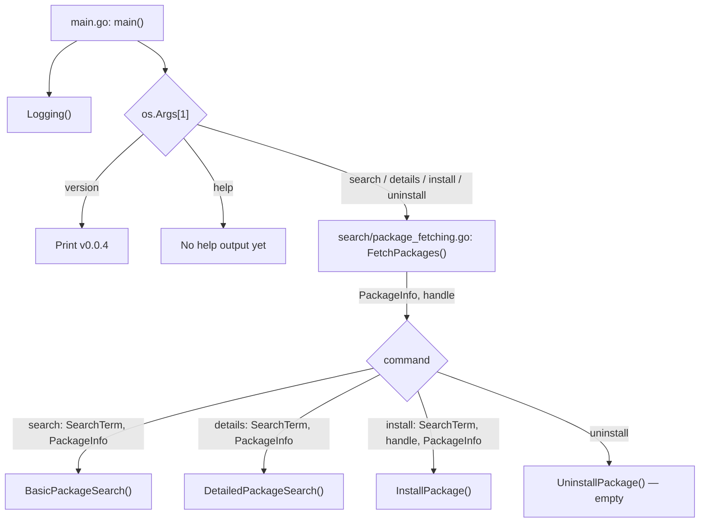
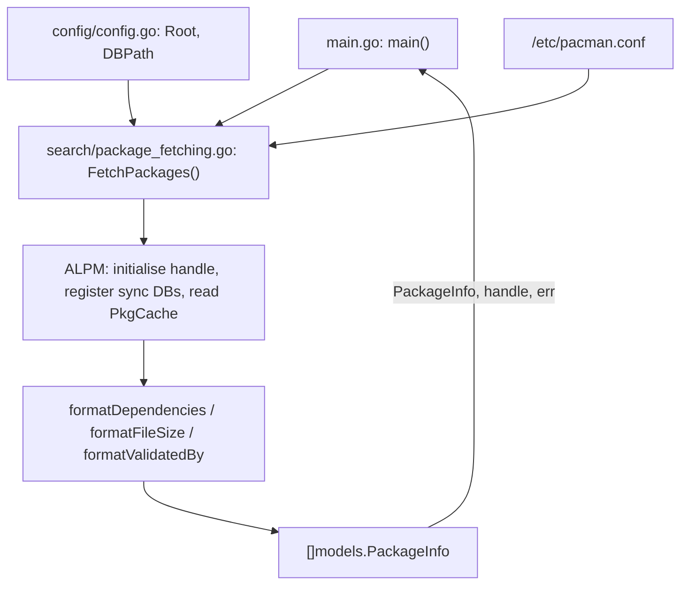
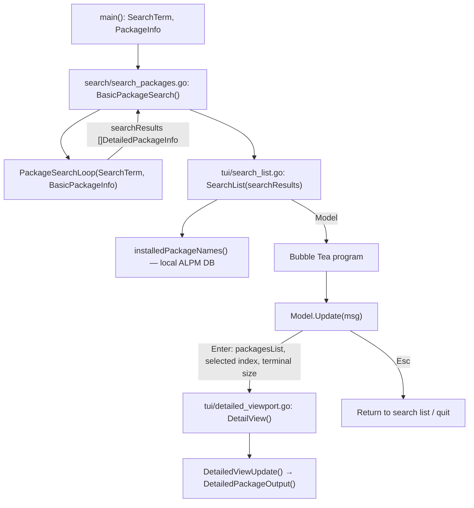
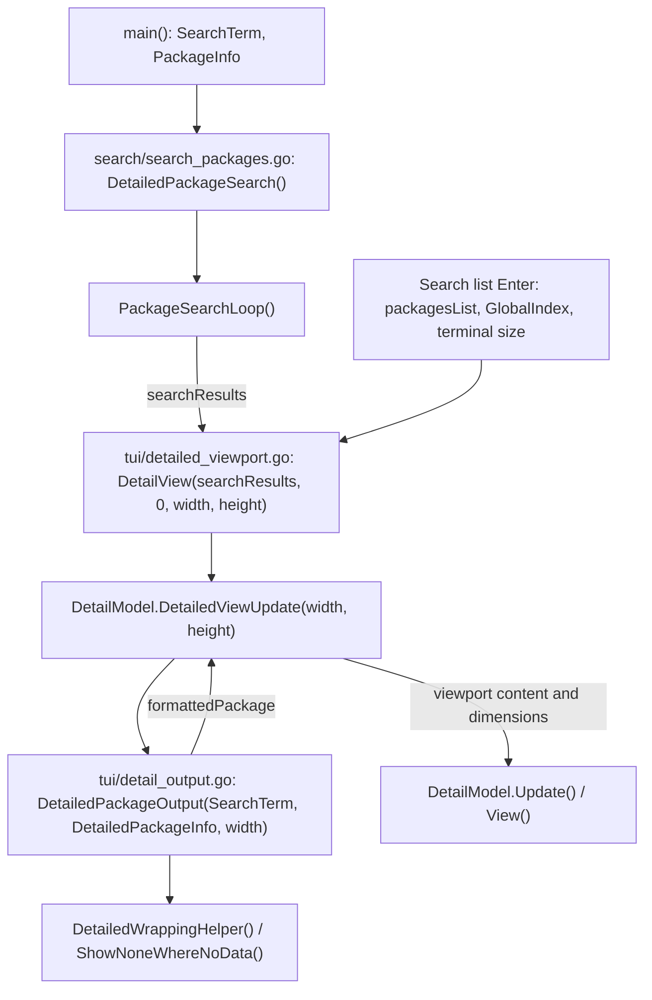
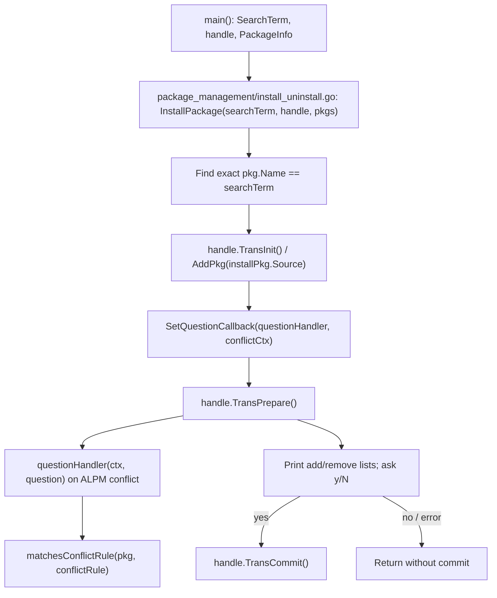
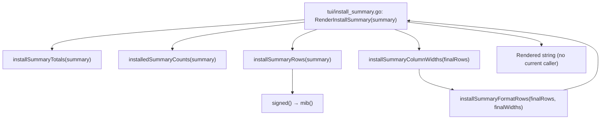
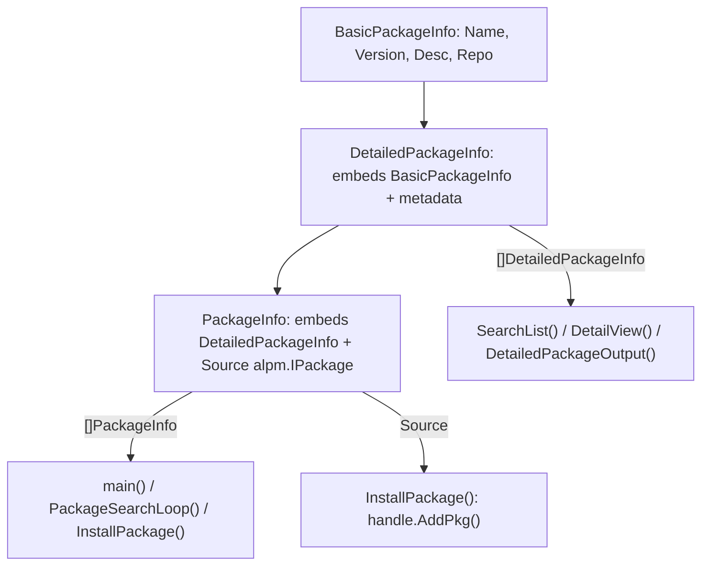

# Capsule — Function Map

> A map of the **current implementation**, not a proposed architecture. Start at a command, follow the arrows, and use the tables to find the code. Paths are relative to the repository root.
>
> This document lives on `docs/code-flow-comments`. It does not change application behaviour.

## Start here: command routes

- `main()` requires a command. For the four package commands it also requires `os.Args[2]`, assigned to `SearchTerm`.
- `FetchPackages()` runs **before all four** package commands, even though `UninstallPackage()` currently does nothing.
- `Logging()` writes to `/mnt/Goku/capsule/logs/capsule.log` (a machine-specific absolute path).
- `main()` does not currently use the error returned by `DetailedPackageSearch()`.

## 1. Load repository packages

| Function | Receives / reads | Produces / next stop |
|---|---|---|
| `FetchPackages()` — `search/package_fetching.go` | `config.Root`, `config.DBPath`, `/etc/pacman.conf`, ALPM sync databases | `PackageInfo []models.PackageInfo`, `handle *alpm.Handle`, `err` → `main()` |
| `formatDependencies(deps)` — same file | ALPM dependency lists from `FetchPackages()` | Names joined into a string → `Provides`, `DependsOn`, `OptionalDeps`, `ConflictsWith`, `Replaces` |
| `formatFileSize(fileSize)` — same file | `pkg.Size()` / `pkg.ISize()` | MiB string → `DownloadSize` / `InstalledSize` |
| `formatValidatedBy(validation)` — same file | `pkg.Validation()` | Readable validation string → `ValidatedBy` |

**Important:** `PackageInfo.Source` retains the original `alpm.IPackage`, which the installer uses. The nested `DetailedPackageInfo` contains the display-ready fields used by search and detail views.

## 2. Search command: `capsule search <term>`

| Function | Receives | Produces / next stop |
|---|---|---|
| `BasicPackageSearch(SearchTerm, BasicPackageInfo)` — `search/search_packages.go` | `SearchTerm`, `PackageInfo` from `main()` | `searchResults` via `PackageSearchLoop()` → `tui.SearchList()` → Bubble Tea |
| `PackageSearchLoop(SearchTerm, packages)` — same file | `SearchTerm`, `[]models.PackageInfo` from either search entry point | `searchResults []models.DetailedPackageInfo` → calling function |
| `SearchList(packages)` — `tui/search_list.go` | `searchResults` from `BasicPackageSearch()` | `Model` containing `packagesList` and list items → Bubble Tea |
| `installedPackageNames()` — same file | Local ALPM database at `/var/lib/pacman/` | `installedPackages map[string]bool` → `SearchList()` |
| `Model.Update(msg)` — same file | Bubble Tea keyboard/size events | Updated `Model`, `tea.Cmd`; Enter calls `DetailView()` |
| `Model.View()` — same file | `m.list`, `m.detail`, `m.showDetails` | `tea.View` to Bubble Tea; overlays detail panel when active |
| `searchListSize(termWidth, termHeight)` — same file | Terminal dimensions | Clamped list width/height → `Model.Update()`, `Model.View()` |

**Search behaviour:** `PackageSearchLoop()` uses case-sensitive `strings.Contains` on package **name or description**. Results can include several repositories for one package name. `SearchList()` labels packages already installed using a separate local ALPM handle.

### Search list item methods (`tui/search_list.go`)

| Method | Value used / purpose |
|---|---|
| `searchItem.Title()` | `packageInfo.Name`, with `[Installed]` when `installed` is true |
| `searchItem.Description()` | `packageInfo.Desc` for the list |
| `searchItem.FilterValue()` | `packageInfo.Name` for list filtering |
| `searchItem.Version()` | Currently returns `packageInfo.Desc`, **not** version |
| `searchItem.Repo()` | Returns `packageInfo.Repo`; no direct call found in this repository |
| `Model.Init()` | Bubble Tea lifecycle hook; returns `nil` |

## 3. Details command and details panel

| Function | Receives | Produces / next stop |
|---|---|---|
| `DetailedPackageSearch(SearchTerm, DetailedPackageInfo)` — `search/search_packages.go` | `SearchTerm`, `PackageInfo` from `main()` | `searchResults` → `DetailView()`; sets `Standalone = true`; runs Bubble Tea |
| `DetailView(packageInfo, selectedRepo, width, height)` — `tui/detailed_viewport.go` | Search matches, selected index, terminal size from details command or list | `DetailModel` → calling function; invokes `DetailedViewUpdate()` |
| `(*DetailModel).DetailedViewUpdate(width, height)` — same file | `m.packagesList`, `m.selectedRepo`, terminal size | `formattedPackage` from `DetailedPackageOutput()` → viewport content and dimensions |
| `DetailModel.Update(msg)` — same file | Bubble Tea events | Updated model; left/right moves between matches, q quits |
| `DetailModel.View()` — same file | Model state and viewport | `tea.View` to Bubble Tea; centred standalone or embedded panel |
| `DetailModel.Init()` — same file | Bubble Tea lifecycle | `nil` command |
| `detailPanelWidth(width)` — same file | Terminal width | Three-quarter-width panel → viewport sizing |
| `detailPanelSize(width, height, contentLines)` — same file | Terminal dimensions, rendered content height | Panel width/height → viewport sizing |
| `DetailedPackageOutput(SearchTerm, DetailedPackageInfo, width)` — `tui/detail_output.go` | Selected package name, package slice, viewport width | Formatted detail string → `DetailedViewUpdate()` |
| `DetailedWrappingHelper(packagesToWrap, width)` — same file | Dependency string and width | Wrapped dependency text → `DetailedPackageOutput()` |
| `ShowNoneWhereNoData(isNone)` — same file | Potentially empty field | Original string or `None` → `DetailedPackageOutput()` |

**Watch-outs:** `DetailView()` indexes `packagesList[selectedRepo]` via `DetailedViewUpdate()`; an empty result set can therefore panic. The search list's Enter handler currently ignores `DetailView()` errors. The `details` command always starts at index 0, while the search list uses the selected global index.

## 4. Install command: `capsule install <package>`

| Function / type | Receives | Produces / next stop |
|---|---|---|
| `InstallPackage(searchTerm, handle, pkgs)` — `package_management/install_uninstall.go` | `SearchTerm`, ALPM `handle`, `PackageInfo` from `main()` | Finds `installPkg.Source`, prepares transaction, prompts, optionally commits |
| `context` — same file | `transactionHandle`, `checkComplete` | Passed as `conflictCtx` to ALPM callback |
| `questionHandler(ctx, question)` — same file | ALPM callback `ctx` and `question` | Checks conflicts, asks about removals, sets `question` answer |
| `matchesConflictRule(pkg, conflictRule)` — same file | Package and ALPM dependency rule from `questionHandler()` | `bool` → `questionHandler()` |
| `UninstallPackage()` — same file | No parameters | **Empty placeholder**; no uninstall action |

**Important:** Installation matches **exact package name** (`searchTerm == pkg.Name`), unlike the substring search command. The install confirmation is currently printed with `fmt`, not the richer `RenderInstallSummary()` formatter below.

## 5. Install-summary formatter (currently disconnected)

| Function | Receives | Returns |
|---|---|---|
| `RenderInstallSummary(summary)` | `InstallSummary` | Multi-line preview string; **no caller in current code** |
| `installSummaryTotals(instSummary)` | `Add` / `Remove` rows | `downloadSize`, `installedSize`, `previousSize` |
| `installedSummaryCounts(instSummary)` | `Add` rows | Install/upgrade/reinstall counts and already-installed package names |
| `installSummaryRows(instSummary)` | `Add` rows | Table rows (`buildRows`) |
| `installSummaryColumnWidths(summaryRows)` | Table rows | `columnWidth` |
| `installSummaryFormatRows(summaryRows, columnWidths)` | Rows and widths | `completeLines` |
| `mib(number)` | Byte count | MiB string |
| `signed(n)` | Signed byte difference | Formatted size string |

`InstallSummary` holds `Add` and `Remove` slices of `InstallSummaryRow` (repo, name, versions, sizes). At present the formatter is **not called by** `InstallPackage()`; it is separate, unfinished integration work. `installSummaryRows()` currently builds rows from `Add` only.

## 6. Shared data models

All defined in `models/models.go`:

- **`BasicPackageInfo`**: name, version, description, repository.
- **`DetailedPackageInfo`**: embeds basic fields and adds architecture, URL, dependency strings, sizes, build date, validation and other display metadata.
- **`PackageInfo`**: embeds detailed fields and adds `Source alpm.IPackage` for operations against libalpm.
- The `PackageSearchLoop()` conversion from `[]PackageInfo` to `[]DetailedPackageInfo` **drops the `Source` handle** from TUI results.

## 7. File index

| File | Responsibility |
|---|---|
| `main.go` | CLI dispatch and logger setup |
| `config/config.go` | ALPM root and database path constants |
| `models/models.go` | Shared package data structures |
| `search/package_fetching.go` | Pacman configuration, sync DBs, package conversion and formatting helpers |
| `search/search_packages.go` | Search filtering and search/detail entry points |
| `package_management/install_uninstall.go` | Install transaction, conflict callback, uninstall placeholder |
| `tui/search_list.go` | Search list, installed markers, Bubble Tea event loop |
| `tui/detailed_viewport.go` | Details viewport, navigation and sizing |
| `tui/detail_output.go` | Detail text formatting and wrapping |
| `tui/install_summary.go` | Standalone install-preview formatting helpers (not wired in) |

## 8. Known gaps and useful landmarks

These are observations from the code, **not changes made by this document**:

1. `UninstallPackage()` is empty, although the CLI exposes `uninstall`.
2. `RenderInstallSummary()` and its helper chain have no integration with `InstallPackage()`.
3. `help` is recognised but currently prints no help text.
4. `DetailView()` assumes at least one matching package; empty detail searches need handling.
5. `Logging()` uses a hard-coded `/mnt/Goku/...` path.
6. `searchItem.Version()` returns the description, despite its name.
7. `FetchPackages()` logs some ALPM errors and continues; error handling deserves review before relying on it for destructive operations.
8. The search list's detail-opening path ignores the returned `DetailView()` error.
9. Search is case-sensitive substring matching; install is exact-name matching.
10. The `DetailedPackageSearch()` file retains a large commented-out previous output implementation.

## Keeping this map useful

When you add a command or connect a new subsystem, update **its command diagram**, **the affected function table**, and **the file index**. Keep the short in-code comments as quick breadcrumbs; use this document for the bigger picture.

*Mapped against the `docs/code-flow-comments` branch on 10 November 2026.*
