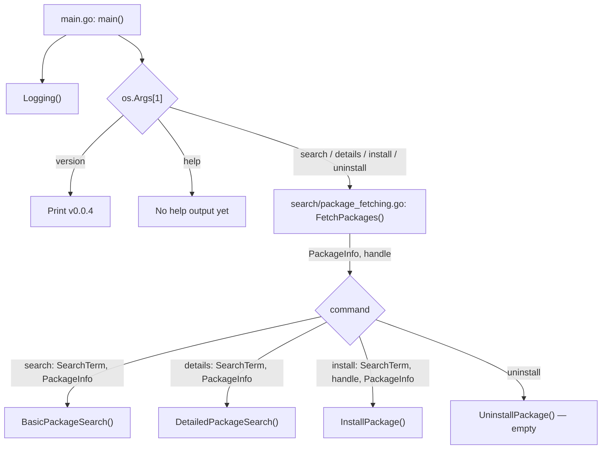
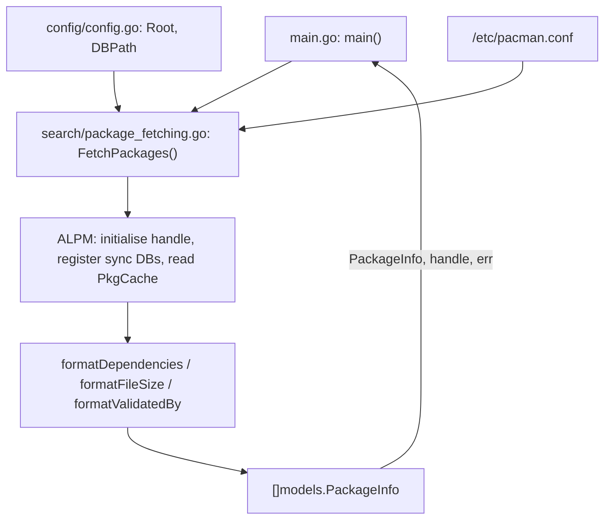
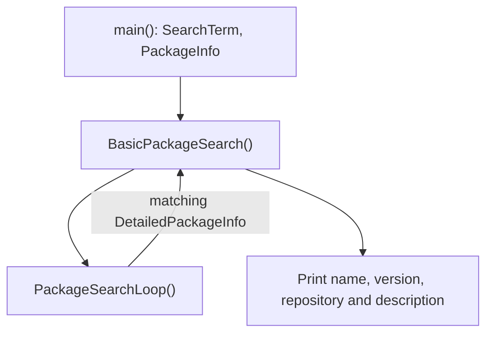
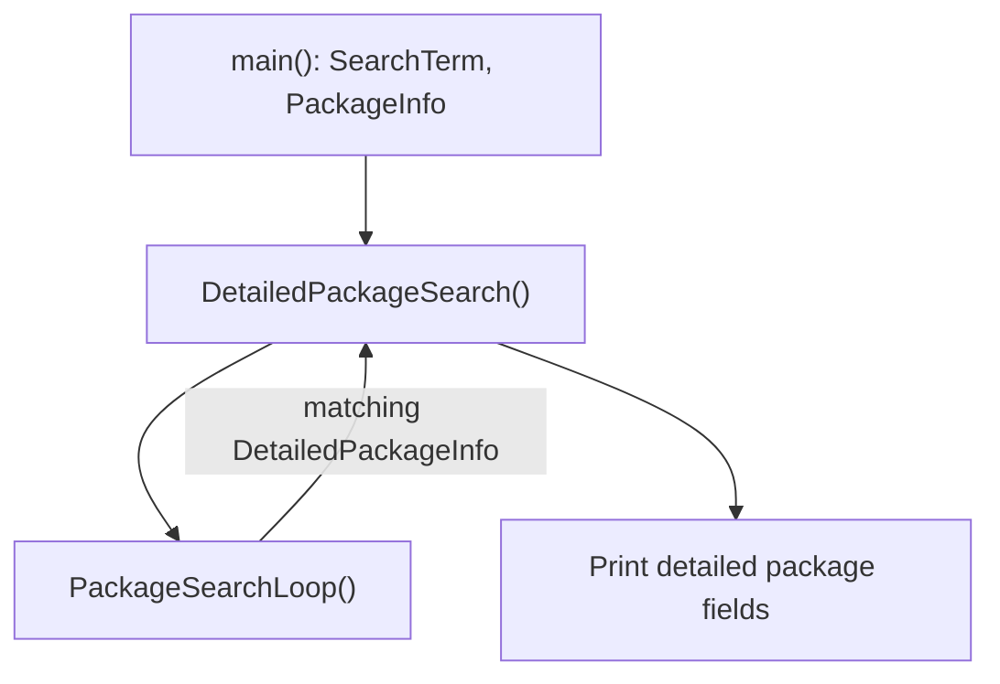
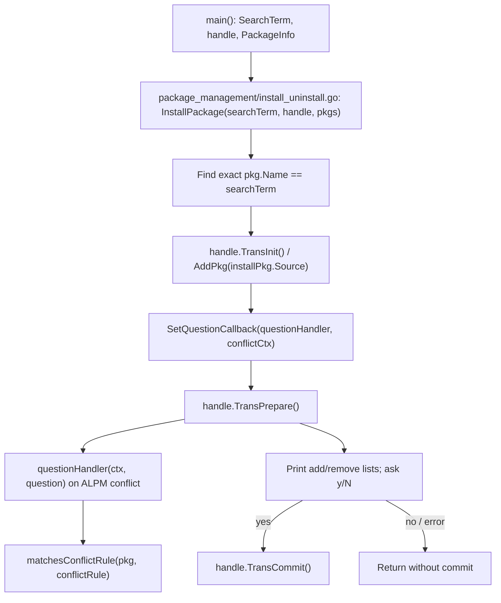

# Capsule — Function Map

> A map of the **current implementation**, not a proposed architecture. Start at a command, follow the arrows, and use the tables to find the code. Paths are relative to the repository root.
>
> This document describes the CLI implementation.

## Start here: command routes

- `main()` requires a command. For the four package commands it also requires `os.Args[2]`, assigned to `SearchTerm`.
- `FetchPackages()` runs **before all four** package commands, even though `UninstallPackage()` currently does nothing.
- `Logging()` writes to `/mnt/Goku/capsule/logs/capsule.log` (a machine-specific absolute path).
- `main()` does not currently use the error returned by `DetailedPackageSearch()`.

## 1. Load repository packages

| Function | Receives / reads | Produces / next stop |
|---|---|---|
| `FetchPackages()` — `search/package_fetching.go` | `config.Root`, `config.DBPath`, `/etc/pacman.conf`, ALPM sync databases | `PackageInfo []models.PackageInfo`, `handle *alpm.Handle`, `err` → `main()` |
| `formatDependencies(deps)` — same file | ALPM dependency lists from `FetchPackages()` | Names joined into a string → `Provides`, `DependsOn`, `OptionalDeps`, `ConflictsWith`, `Replaces` |
| `formatFileSize(fileSize)` — same file | `pkg.Size()` / `pkg.ISize()` | MiB string → `DownloadSize` / `InstalledSize` |
| `formatValidatedBy(validation)` — same file | `pkg.Validation()` | Readable validation string → `ValidatedBy` |

**Important:** `PackageInfo.Source` retains the original `alpm.IPackage`, which the installer uses. The nested `DetailedPackageInfo` contains the display-ready fields used by search and detail views.

## 2. Search command: `capsule search <term>`

| Function | Receives | Produces / next stop |
|---|---|---|
| `BasicPackageSearch(SearchTerm, BasicPackageInfo)` | Search term and packages from `main()` | Prints each match returned by `PackageSearchLoop()` |
| `PackageSearchLoop(SearchTerm, packages)` | Search term and `[]models.PackageInfo` | Returns `[]models.DetailedPackageInfo` to either search function |

**Search behaviour:** `PackageSearchLoop()` uses case-sensitive `strings.Contains` on package **name or description**. Results can include several repositories for one package name.

## 3. Details command: `capsule details <term>`

`DetailedPackageSearch()` prints the detailed fields for each match returned by the same search loop. With no matches, it prints nothing.

## 4. Install command: `capsule install <package>`

| Function / type | Receives | Produces / next stop |
|---|---|---|
| `InstallPackage(searchTerm, handle, pkgs)` — `package_management/install_uninstall.go` | `SearchTerm`, ALPM `handle`, `PackageInfo` from `main()` | Finds `installPkg.Source`, prepares transaction, prompts, optionally commits |
| `context` — same file | `transactionHandle`, `checkComplete` | Passed as `conflictCtx` to ALPM callback |
| `questionHandler(ctx, question)` — same file | ALPM callback `ctx` and `question` | Checks conflicts, asks about removals, sets `question` answer |
| `matchesConflictRule(pkg, conflictRule)` — same file | Package and ALPM dependency rule from `questionHandler()` | `bool` → `questionHandler()` |
| `UninstallPackage()` — same file | No parameters | **Empty placeholder**; no uninstall action |

**Important:** Installation matches **exact package name** (`searchTerm == pkg.Name`), unlike the substring search command. The install confirmation is printed with `fmt`.

## 5. Shared data models

All defined in `models/models.go`:

- **`BasicPackageInfo`**: name, version, description, repository.
- **`DetailedPackageInfo`**: embeds basic fields and adds architecture, URL, dependency strings, sizes, build date, validation and other display metadata.
- **`PackageInfo`**: embeds detailed fields and adds `Source alpm.IPackage` for operations against libalpm.
- The `PackageSearchLoop()` conversion from `[]PackageInfo` to `[]DetailedPackageInfo` **drops the `Source` handle** from search results.

## 6. File index

| File | Responsibility |
|---|---|
| `main.go` | CLI dispatch and logger setup |
| `config/config.go` | ALPM root and database path constants |
| `models/models.go` | Shared package data structures |
| `search/package_fetching.go` | Pacman configuration, sync DBs, package conversion and formatting helpers |
| `search/search_packages.go` | Search filtering and search/detail entry points |
| `package_management/install_uninstall.go` | Install transaction, conflict callback, uninstall placeholder |

## 7. Known gaps and useful landmarks

These are observations from the code, **not changes made by this document**:

1. `UninstallPackage()` is empty, although the CLI exposes `uninstall`.
2. `help` is recognised but currently prints no help text.
3. `Logging()` uses a hard-coded `/mnt/Goku/...` path.
4. `FetchPackages()` logs some ALPM errors and continues; error handling deserves review before relying on it for destructive operations.
5. Search is case-sensitive substring matching; install is exact-name matching.

## Keeping this map useful

When you add a command or connect a new subsystem, update **its command diagram**, **the affected function table**, and **the file index**. Keep the short in-code comments as quick breadcrumbs; use this document for the bigger picture.

*Updated for the CLI implementation on 10 November 2026.*
